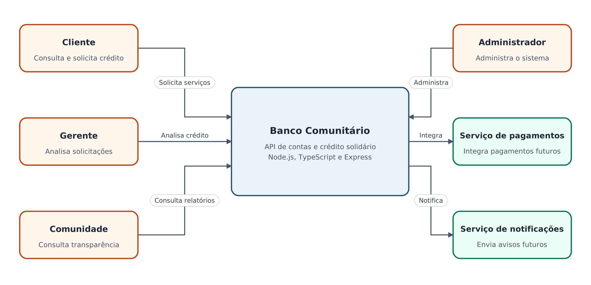
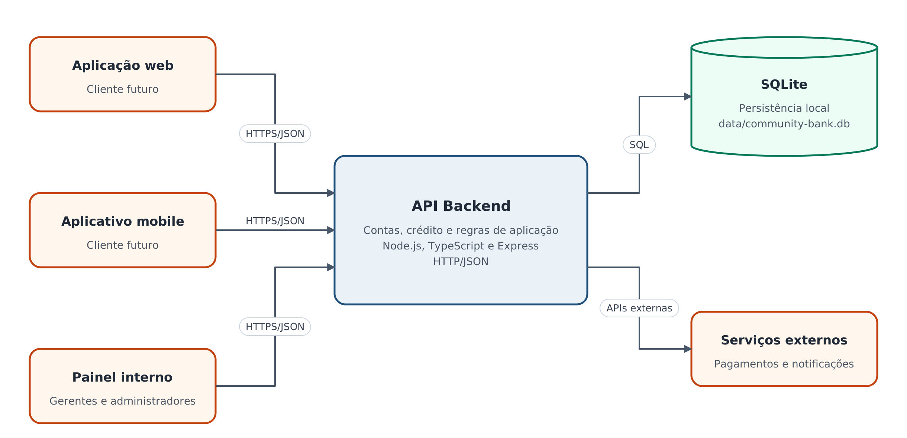
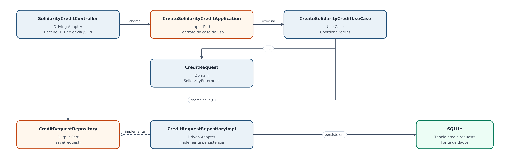

# Banco Comunitário - Arquitetura C4 e ADRs

## 1. Visão arquitetural

O Banco Comunitário é uma API que oferece serviços financeiros para clientes e empreendimentos solidários, como contas e solicitações de crédito.

O sistema utiliza Node.js, TypeScript e Express, seguindo o modelo cliente-servidor. A aplicação é organizada como um monólito modular e usa Arquitetura Hexagonal no módulo de crédito. Os dados são armazenados em SQLite. Essa estrutura mantém o sistema simples, organizado e fácil de evoluir.

### Principais stakeholders

- Clientes e correntistas: consultam contas e solicitam serviços financeiros.
- Empreendimentos solidários: solicitam crédito para trabalho e geração de renda.
- Gerentes: analisam solicitações e acompanham clientes.
- Administradores: mantêm usuários, configurações e operação do banco.
- Conselho e comunidade: acompanham relatórios e transparência.
- Equipe de desenvolvimento: mantém e evolui o sistema.

### Restrições relevantes

- A API deve utilizar Node.js, TypeScript e Express.
- A persistência deve funcionar localmente sem depender de um servidor externo.
- O domínio financeiro exige integridade, privacidade, auditoria e possibilidade de evolução.
- A infraestrutura disponível para o projeto é pequena, o que desaconselha microserviços neste momento.

## 2. Decisões arquiteturais já adotadas

1. Usar um monólito modular para manter a execução simples.
2. Usar HTTP e JSON na comunicação entre clientes e API.
3. Separar o módulo de crédito com Ports and Adapters.
4. Usar SQLite por meio de um adaptador de persistência.
5. Manter as regras do caso de uso independentes de Express e SQLite.

## 3. Documentação C4

### 3.1 Contexto - C4 nível 1

O diagrama mostra a fronteira do Banco Comunitário, as pessoas que interagem com o sistema e integrações externas futuras.

### 3.2 Contêineres - C4 nível 2

O contêiner principal é a API Backend. Os clientes podem ser uma aplicação web, um aplicativo mobile ou um painel interno. O SQLite representa o armazenamento atual.

### 3.3 Componentes - C4 nível 3

O contêiner detalhado é a API Backend, com foco no fluxo de solicitação de crédito solidário. O Controller é o adaptador de entrada; o caso de uso e o domínio ficam no núcleo; o Repository é a porta de saída; e o adaptador SQLite acessa a fonte de dados.

